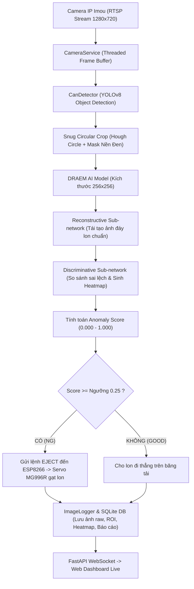

# BÁO CÁO KỸ THUẬT: KIẾN TRÚC HỆ THỐNG & MÔ HÌNH AI DRAEM

Tài liệu mô tả chi tiết kiến trúc phần mềm, thuật toán thị giác máy tính và mạng nơ-ron học sâu phát hiện dị tật đáy lon bia (DRAEM - Discriminative Reconstructive Anomaly Embedding).

---

## 1. TỔNG QUAN LUỒNG DỮ LIỆU (DATA PIPELINE)

Hệ thống hoạt động theo chu trình khép kín thời gian thực:

---

## 2. THUẬT TOÁN ĐỊNH VỊ & CẮT TRÒN ÔM SÁT (SNUG CIRCULAR CROP)

Đáy lon bia có dạng hình tròn bằng nhôm bóng. Khi chạy trên băng tải, ảnh chụp từ camera thường bị ảnh hưởng bởi:
- Thành chắn kim loại của băng chuyền.
- Dây đai cao su đen bên dưới.
- Ánh sáng phản xạ không đều trên viền ngoài lon.

### Giải pháp kỹ thuật:
1. **Phát hiện vùng lon (YOLOv8):** Định vị nhanh khung bao Bounding Box `[x1, y1, x2, y2]` chứa lon bia với độ tin cậy `confidence >= 0.65`.
2. **Hough Circle Gradient:**
   - Chuyển vùng ảnh cắt sang không gian màu xám (Grayscale).
   - Áp dụng bộ lọc làm mịn Gaussian Blur `(9, 9)` giảm nhiễu hạt.
   - Sử dụng giải thuật Hough Circle tìm tâm lon `(cx, cy)` và bán kính chính xác `r`.
3. **Mặt nạ hình tròn (Circular Mask):**
   - Tạo mặt nạ nhị phân tròn tâm `(cx, cy)` bán kính `r`.
   - Phủ màu đen tuyền `(0, 0, 0)` toàn bộ vùng bên ngoài đường tròn.
   - Toàn bộ bề mặt đáy lon bên trong được giữ nguyên bản 100%.
   - Resize đồng nhất về kích thước chuẩn `256 x 256` trước khi đưa vào mô hình DRAEM.

---

## 3. KIẾN TRÚC MÔ HÌNH HỌC SÂU DRAEM

DRAEM là mô hình học không giám sát (Unsupervised / Self-Supervised Anomaly Detection) gồm 2 mạng con phối hợp:

### 3.1. Reconstructive Sub-network (Mạng tái tạo)
- **Kiến trúc:** Autoencoder dựa trên kiến trúc U-Net sâu với các kết nối tắt (Skip Connections).
- **Nhiệm vụ:** Nhận ảnh đầu vào (dù có khuyết tật hay không) và tái tạo lại hình ảnh đáy lon nhôm ở trạng thái hoàn hảo, không có lỗi.
- **Cơ chế huấn luyện:**
  - Trong quá trình train, mô hình chỉ học trên tập ảnh lon đạt chuẩn (OK).
  - Thuật toán tự động sinh dị tật nhân tạo (Synthetic Anomalies) bằng Perlin Noise kết hợp trộn cấu trúc bề mặt ngẫu nhiên.
  - Hàm mất mát tái tạo:
    $$\mathcal{L}_{recon} = \mathcal{L}_{L2}(I_{recon}, I_{clean}) + \mathcal{L}_{SSIM}(I_{recon}, I_{clean})$$
    (Kết hợp giữa sai số bình phương trung bình $L2$ và chỉ số tương đồng cấu trúc $SSIM$).

### 3.2. Discriminative Sub-network (Mạng phân biệt)
- **Kiến trúc:** Mạng phân đoạn U-Net nhận đầu vào là ảnh ghép nối (Concatenation) 6 kênh gồm:
  - 3 kênh của ảnh gốc: $I_{input}$
  - 3 kênh của ảnh tái tạo: $I_{recon}$
- **Nhiệm vụ:** So sánh sự sai lệch giữa ảnh thực tế và ảnh tái tạo lý tưởng, từ đó xuất ra bản đồ xác suất bất thường kích thước $256 \times 256$ với từng pixel mang giá trị từ $0.0$ đến $1.0$.
- **Hàm mất mát phân đoạn:**
  $$\mathcal{L}_{seg} = \mathcal{L}_{Focal}(M_{pred}, M_{gt})$$
  (Sử dụng Focal Loss để tập trung tối đa vào các chi tiết lỗi nhỏ, mất cân bằng điểm ảnh).

---

## 4. TÍNH TOÁN ĐIỂM SỐ ANOMALY SCORE & PHÂN LOẠI

Từ bản đồ xác suất bất thường $M_{pred} \in [0, 1]^{256 \times 256}$:
1. Áp dụng bộ lọc trung bình động làm mịn bản đồ nhiệt.
2. Lấy trung bình của Top $K$ phần tử có điểm số cao nhất (vùng tập trung bất thường lớn nhất):
   $$\text{Score} = \frac{1}{K} \sum_{i=1}^{K} M_{sorted}[i]$$
3. **Quy tắc phân loại:**
   - Nếu $\text{Score} < 0.25 \implies \text{Kết quả: } \mathbf{GOOD}$ (Đạt chuẩn).
   - Nếu $\text{Score} \ge 0.25 \implies \text{Kết quả: } \mathbf{NG}$ (Phế phẩm / Lỗi).

---

## 5. THỰC THI THỜI GIAN THỰC & ĐỘ TRỄ (BENCHMARK)

Kiểm thử trên phần cứng: **NVIDIA GPU CUDA, Camera Imou 30 FPS**:

| Giai đoạn xử lý | Thời gian trung bình |
| :--- | :--- |
| Thu nhận khung hình (Camera Buffer) | ~2 ms |
| YOLOv8 Can Detection & Snug Crop | ~8 ms |
| DRAEM Reconstructor & Discriminator | ~14 ms |
| Sinh Heatmap & Đánh giá Score | ~3 ms |
| Ghi log SQLite & Lưu ảnh bất đồng bộ | ~2 ms |
| **TỔNG THỜI GIAN XỬ LÝ 1 LON** | **~29 ms** ($\approx 34$ lon/giây) |

Tốc độ xử lý hoàn toàn vượt trội so với tốc độ di chuyển của băng chuyền thực tế (~1 - 2 lon/giây), đảm bảo không bao giờ bị nghẽn luồng hay trễ nhịp phân loại.
